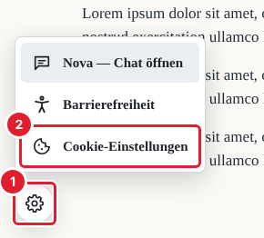
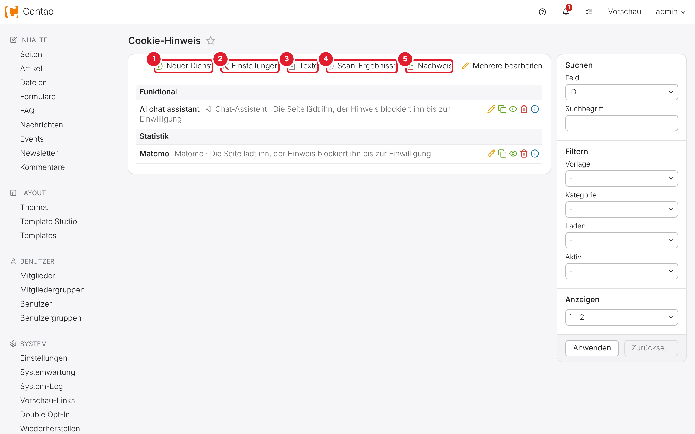

# Bedienungsanleitung

Alles liegt unter **NEO Digital › Cookie-Hinweis**. Das Modul öffnet mit der
Liste der Dienste, nach Kategorie gruppiert. Über der Liste stehen die
Schaltflächen **Einstellungen**, **Texte**, **Scan-Ergebnisse** und
**Nachweis**; jede Unterseite hat **Dienste** für den Weg zurück zur Liste.

Hinweise über der Liste zeigen offene Aufgaben: „Der Cookie-Hinweis ist
ausgeschaltet. Einschalten unter „Einstellungen“.“ – „Es ist keine Seite für
die Datenschutzerklärung gewählt. …“ – „Unbekannte Adressen aus dem Scan: 2.
Bitte unter „Scan-Ergebnisse“ prüfen.“

## Was Besucher sehen

### Erste Ebene

Eine Überschrift („Cookies und Dienste“), ein Text und drei gleichwertige
Knöpfe: **Einstellungen**, **Nur notwendige**, **Alle akzeptieren**. Der Text
nennt jede Kategorie mit ihren Diensten, z. B. „Statistik (Google Analytics
4); Marketing (Meta Pixel (Facebook, Instagram))“, und ob Daten in die USA oder
andere Länder außerhalb der EU gehen können. Darunter stehen die Links zu
Datenschutzerklärung und Impressum.

Im Bild: 1 der Text mit den Kategorien und ihren Diensten, 2 die drei Knöpfe,
3 die Links.

### Zweite Ebene

**Einstellungen** öffnet die Cookie-Einstellungen: ein Schalter je Kategorie,
die Dienste jeder Kategorie mit Anbieter, Zweck, Cookies samt Speicherdauer,
Drittland und Link zur Datenschutzerklärung des Anbieters (hinter **Dienste
anzeigen (…)**), die Knöpfe **Zurück**, **Auswahl speichern** und **Alle
akzeptieren**, und die Einwilligungs-ID des Besuchers, sobald es eine Wahl
gibt. *Notwendig* ist immer an und lässt sich nicht ausschalten. Eine
Kategorie ohne Dienst erscheint nicht.

Im Bild: 1 der Schalter einer Kategorie, 2 ihre Dienste, 3 die Knöpfe.

### Eingebettete Inhalte

Videos, Karten und Beiträge eines Dienstes ohne Einwilligung zeigen einen
Platzhalter: „Hier wird ein Inhalt von YouTube angezeigt. Beim Laden werden
Daten wie Ihre IP-Adresse an … übermittelt.“, mit **Inhalt laden** (dieses
eine Mal) und **YouTube immer erlauben** (erlaubt den Dienst ab jetzt).

### Wahl ändern

Besucher öffnen die Einstellungen wieder mit dem kleinen Knopf am unteren Rand,
mit dem Link `{{cookie_consent::settings}}` oder mit dem Link unter der
Cookie-Liste. Schaltet ein Besucher eine Kategorie aus, die an war, löscht die
Erweiterung die Cookies ihrer Dienste (und Einträge im Browserspeicher mit den
Namen, die bei ihnen stehen) und lädt die Seite neu.

### Zusammen mit anderen Knöpfen in derselben Ecke

Der Knopf zum Wiederöffnen gehört zu den Schaltflächen am Bildschirmrand von
NEO Basic. Sitzen Knöpfe anderer Erweiterungen in derselben Ecke (etwa das
Barrierefreiheits-Panel von NEO Accessibility oder der Chat von NEO
SuperAgent), werden sie gemeinsam angeordnet, wie es im Seitenlayout unter
**Schaltflächen am Bildschirmrand** eingestellt ist: eine Einstellungs-
Schaltfläche mit Menü (die Vorgabe), übereinander gestapelt oder nebeneinander.
Allein in seiner Ecke bleibt der Knopf zum Wiederöffnen, wie er ist.

1. Die **Einstellungs-Schaltfläche** (ein Zahnrad) in der gemeinsamen Ecke.
2. **Cookie-Einstellungen** in ihrem Menü öffnet die Einstellungen des
   Hinweises, wie der Knopf zum Wiederöffnen.

Mit der Tastatur: Enter, Leertaste oder Pfeil nach unten öffnet das Menü beim
ersten Eintrag, Pfeil nach oben beim letzten; die Pfeiltasten wandern durch
die Einträge, Pos1 und Ende springen zum ersten und letzten; Esc schließt das
Menü, der Fokus kehrt zur Einstellungs-Schaltfläche zurück, Tab schließt es
und geht weiter. Schließen sich die Cookie-Einstellungen, kehrt der Fokus zur
Einstellungs-Schaltfläche zurück.

### Wann Besucher neu gefragt werden

Der Hinweis fragt alle Besucher neu, wenn sich eines davon ändert: Ein Dienst
kommt hinzu, wird entfernt oder ausgeschaltet, oder sein Name, seine Kategorie,
sein Anbieter, Zweck, Drittland, seine Websites oder seine Namen je Sprache
ändern sich. Änderungen nur an den Cookies oder am Datenschutz-Link des
Anbieters fragen nicht neu. Die aktuelle Version steht unten in den
**Einstellungen**.

Der Hinweis erscheint nur, wenn mindestens ein aktiver Dienst der Website eine
Einwilligung braucht (eine andere Kategorie als *Notwendig*). Ohne einen
solchen Dienst sehen Besucher höchstens Platzhalter für blockierte
eingebettete Inhalte.

## Dienste

Jede Zeile zeigt den Namen, die Vorlage (oder „Eigener Dienst“), wie der Dienst
lädt, seine Kennung und bei Diensten aus dem Scan „vom Scan gefunden am …“.
„Kennung fehlt“ in Rot heißt: Der Hinweis soll den Dienst laden, hat aber keine
gültige Kennung.

Aktionen je Zeile: **Bearbeiten**, **Kopieren**, **Ein/aus**, **Löschen**,
**Details**. Nur aktive Dienste stehen im Hinweis und in der Cookie-Liste.

Im Bild: 1 **Neuer Dienst**, 2 **Einstellungen**, 3 **Texte**, 4
**Scan-Ergebnisse**, 5 **Nachweis**.

### Kategorien

| Kategorie | Wofür |
| --- | --- |
| **Notwendig** | Was die Website zum Funktionieren braucht. Wird nie blockiert, immer aktiv. Auch die Wahl des Besuchers selbst steht hier. |
| **Funktional** | Eingebettete Inhalte, Chats, Schriften anderer Anbieter, Spam-Schutz |
| **Statistik** | Messung der Nutzung der Website |
| **Marketing** | Werbung, Erfolgsmessung, Remarketing, Erkennen von Unternehmen |

### Dienst aus einer Vorlage anlegen

1. Auf **Neuer Dienst** klicken.
2. Die **Vorlage** wählen, z. B. *Google Analytics 4*. Das Formular lädt neu;
   die Erweiterung füllt **Name**, **Kategorie** und **Laden** aus. Anbieter,
   Zweck, Cookies, Drittland und Datenschutz-Link kommen aus der Vorlage und
   stehen als Platzhalter da: leer lassen, um die Vorlage zu nutzen, oder
   überschreiben.
3. **Laden**:
   - **Der Hinweis lädt ihn nach der Einwilligung**: die **Kennung** aus dem
     Konto beim Anbieter eintragen, z. B. `G-XXXXXXXXXX`. Der Hilfetext des
     Feldes zeigt die Form der Kennung. Bei selbst betriebenem Matomo auch die
     **Adresse des eigenen Servers** mit `https://` eintragen. Den Code des
     Dienstes aus Seitenlayout und Templates entfernen, sonst lädt er doppelt.
   - **Die Seite lädt ihn, der Hinweis blockiert ihn bis zur Einwilligung**:
     Der Code bleibt, wo er ist (Seitenlayout, Template, Inhaltselement). Die
     Erweiterung hält ihn bis zur Einwilligung zurück.

   Vorlagen, die die Erweiterung nicht selbst laden kann (z. B. YouTube),
   haben kein Feld **Laden**: Die Seite lädt sie.
4. **Aktiv** eingeschaltet lassen und speichern.

Eine Kennung, die nicht die Form des Dienstes hat, wird abgelehnt: „Diese
Kennung hat nicht die Form des Dienstes, z. B. G-XXXXXXXXXX.“ Matomo ohne
Adresse: „Bitte die Adresse des eigenen Servers mit https:// angeben.“

Vorlagen (47): Statistik – Google Analytics 4, Google Tag Manager, Matomo,
Microsoft Clarity, Hotjar, etracker Analytics, Mouseflow, Plausible Analytics,
Cloudflare Web Analytics; Marketing – Google Ads, Google AdSense, Meta Pixel
(Facebook, Instagram), LinkedIn Insight Tag, Microsoft Advertising (Bing Ads),
TikTok Pixel, Pinterest Tag, Snap Pixel (Snapchat), X Pixel (Twitter), Reddit
Pixel, Leadinfo, Leadfeeder (Dealfront), HubSpot, Criteo; Funktional –
YouTube, Vimeo, Google Maps, OpenStreetMap, Instagram, Facebook, X (Twitter),
Spotify, SoundCloud, Calendly, Typeform, Brevo, Google Docs, Forms, Calendar,
Google reCAPTCHA, hCaptcha, Cloudflare Turnstile, Google Fonts, Adobe Fonts,
tawk.to, Zendesk Chat, Intercom, Trustpilot, ProvenExpert, KI-Chat-Assistent.

Die Vorlage *KI-Chat-Assistent* ist für einen Chat-Assistenten, der selbst um
Einwilligung bittet; die Erweiterung blockiert ihn nicht. Seine Kategorie muss
die Einwilligungs-Kategorie sein, die am Assistenten eingestellt ist: Ohne
Dienst in dieser Kategorie fragt der Hinweis nie danach, und der Chat sagt, dass
er nicht verfügbar ist. Das Formular des Assistenten zeigt das am Feld
**Einwilligungs-Kategorie**, mit einem Link, der den Dienst hier anlegt.

### Eigener Dienst ohne Vorlage

1. Auf **Neuer Dienst** klicken und **Vorlage** leer lassen.
2. **Name**, **Kategorie**, **Anbieter** (Firma und Ort), **Zweck** (ein Satz
   für Besucher), **Übermittlung in ein Drittland**, **Datenschutzerklärung des
   Anbieters** und die **Cookies** (Name und Speicherdauer je Zeile, z. B.
   `_beispiel` und `1 Jahr`) eintragen.
3. Entweder:
   - **Laden** = *Die Seite lädt ihn, der Hinweis blockiert ihn bis zur
     Einwilligung*, und unter **Adressen** die Domains, deren Skripte und
     eingebettete Inhalte blockiert werden, eine je Zeile, z. B.
     `widget.example.com`. Subdomains sind eingeschlossen.
   - oder **Laden** = *Der Hinweis lädt ihn nach der Einwilligung* und der
     **Eigene Code** (HTML oder Skript, das nach der Einwilligung in den
     Seitenkopf eingefügt wird). Dieses Feld sehen nur Administratoren.
4. Speichern und den Dienst mit **Aktiv** einschalten.

### Websites und Sprachen

- **Websites** (Abschnitt *Adressen und Websites*): Den Dienst nur auf den
  angekreuzten Websites zeigen. Keine Auswahl = alle Websites.
- **Sprachen**: erscheint nur, wenn die Installation mehr als eine Sprache hat.
  Name und Zweck je Sprache; leere Felder nutzen Name und Zweck von oben bzw.
  den Text der Vorlage in dieser Sprache.

### Dienste, die die Erweiterung auch ohne Eintrag erkennt

Skripte, Schriften und eingebettete Inhalte der 47 Vorlagen werden schon
zurückgehalten, bevor der Dienst eingetragen ist. Trotzdem alle eintragen: Nur
eingetragene Dienste stehen im Hinweis und in der Cookie-Liste, und nur dann
können Besucher sie in den Einstellungen erlauben.

Elemente mit dem Attribut `data-ncc-ignore` werden nie blockiert. Eine Vorlage
unter *Notwendig* wird ebenfalls nicht blockiert.

## Scan-Ergebnisse

**Scan-Ergebnisse** führt, was der Scan gefunden hat: die Fundstelle (Dienst
oder Adresse), auf wie vielen Seiten und wann zuletzt gesehen. **Jetzt prüfen**
startet den Scan sofort. Die Zeile über der Liste sagt, wann der letzte Scan
lief und wie viele Seiten er gelesen hat.

| Status | Bedeutung |
| --- | --- |
| **neu** | Zum ersten Mal gefunden, noch nicht entschieden |
| **als Dienst ergänzt** | Eine Vorlage, die der Scan bei den Diensten ergänzt hat |
| **steht im Hinweis** | Der Dienst ist schon eingetragen |
| **unbekannt** | Ein Skript oder iframe eines anderen Hosts, den der Katalog nicht kennt |
| **ignoriert** | Wird nie als Dienst ergänzt |

- **Als Dienst anlegen** (unbekannte Adresse) legt einen eigenen Dienst an, der
  diesen Host blockiert. Er ist inaktiv: Kategorie, Anbieter und Zweck
  ergänzen, dann **Aktiv** einschalten. Bestätigung: „Dienst angelegt. Bitte
  Kategorie, Anbieter und Zweck ergänzen und ihn dann aktivieren.“
- **Bearbeiten** ändert den Status, z. B. auf **ignoriert** für eine Adresse,
  die keine Einwilligung braucht.
- „lädt ohne Einwilligung“: Auf mindestens einer Seite lief der Dienst ohne
  Einwilligung. Prüfen, ob **Skripte blockieren** an ist, oder die Adresse als
  Dienst anlegen.

Der tägliche Scan ergänzt Dienste des Katalogs selbst (aktiv, *Die Seite lädt
ihn*) und schickt eine E-Mail, wenn er einen Dienst ergänzt oder eine neue
unbekannte Adresse gefunden hat. Adressen der eigenen Domain meldet er nicht.

## Texte je Sprache

Jeder leere Text nutzt die Vorgabe der Sprache: Elf Sprachen liegen bei, jede
andere Sprache bekommt Englisch.

1. Auf **Texte** und dann auf **Neue Sprache** klicken.
2. Die **Sprache** wählen (die Sprachen der Startpunkte stehen vorn). Jede
   Sprache gibt es einmal.
3. Nur ausfüllen, was abweichen soll. Abschnitte: *Erste Ebene* (Überschrift,
   Text), *Einstellungen* (Überschrift der Einstellungen, Text der
   Einstellungen, Dienste anzeigen, Einwilligungs-ID), *Knöpfe* (Alle
   akzeptieren, Nur notwendige, Einstellungen, Auswahl speichern, Zurück,
   Cookie-Einstellungen), *Kategorien* (Bezeichnung und Beschreibung jeder
   Kategorie), *Eingebettete Inhalte* (Platzhalter, Inhalt laden, Immer
   erlauben), *Links* (Datenschutzerklärung dieser Sprache, Impressum dieser
   Sprache, Linktexte).
4. Speichern.

Platzhalter in den Texten:

| Feld | Platzhalter | Wird ersetzt durch |
| --- | --- | --- |
| **Text** (erste Ebene) | `{services}` | die Kategorien mit ihren Diensten |
| | `{transfer}` | den Satz zur Übermittlung in die USA oder andere Drittländer, wenn ein Dienst eine hat |
| **Dienste anzeigen** | `{count}` | die Zahl der Dienste der Kategorie |
| **Platzhalter** | `{name}`, `{provider}` | Name und Anbieter des Dienstes |
| **Knopf „Immer erlauben“** | `{name}` | Name des Dienstes |

Eine Änderung an den Texten fragt Besucher nicht neu.

## Nachweis der Einwilligung

**Nachweis** führt jede Wahl der Besucher, die neueste zuerst: Zeit,
Einwilligungs-ID, Aktion, erlaubte Kategorien und Version, nach Tag gruppiert.
Der Filter wählt nach Aktion; die Suche findet eine Einwilligungs-ID.
**Details** zeigt einen Eintrag, auch **Einzeln erlaubte Dienste**.

| Aktion | Bedeutung |
| --- | --- |
| Alle akzeptiert | **Alle akzeptieren** |
| Nur notwendige | **Nur notwendige** |
| Auswahl gespeichert | **Auswahl speichern** in den Einstellungen |
| Inhalt immer erlaubt | **… immer erlauben** an einem Platzhalter |

Besucher finden ihre Einwilligungs-ID in den Einstellungen des Hinweises oder
dort, wo `{{cookie_consent::id}}` steht. Einträge lassen sich von Hand weder
ändern noch löschen; der tägliche Cron löscht sie nach der Frist unter
**Aufbewahren**.

## Insert-Tags und Inhaltselement

| Wo | Was |
| --- | --- |
| `{{cookie_consent::table}}` oder Inhaltselement **Cookie-Liste** | Tabellen aller Dienste für die Datenschutzerklärung |
| `{{cookie_consent::settings}}`, `{{cookie_consent::settings::Eigene Beschriftung}}` | Link, der die Cookie-Einstellungen öffnet |
| `{{cookie_consent::id}}` | Einwilligungs-ID des Besuchers |

Einzelheiten: [Einrichtung](setup.md#4-cookie-liste-in-der-datenschutzerklärung).

## Häufige Fehler

| Was passiert | Was zu tun ist |
| --- | --- |
| Der Hinweis erscheint nicht | Es braucht mindestens einen aktiven Dienst mit einer anderen Kategorie als *Notwendig*; **Hinweis zeigen** in den **Einstellungen** prüfen. |
| Ein Dienst lädt doppelt | Er steht auf *Der Hinweis lädt ihn nach der Einwilligung*, und sein Code steht noch im Layout. Den Code entfernen oder **Laden** auf *Die Seite lädt ihn* stellen. |
| Ein neuer Dienst fehlt im Hinweis | **Aktiv** ist aus, oder **Websites** enthält diese Website nicht. |
| Die Cookie-Liste ist veraltet | Sie zeigt immer die aktiven Dienste; die Dienste ergänzen oder berichtigen. |

Mehr: [Fehlersuche](troubleshooting.md).
