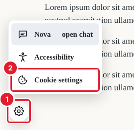
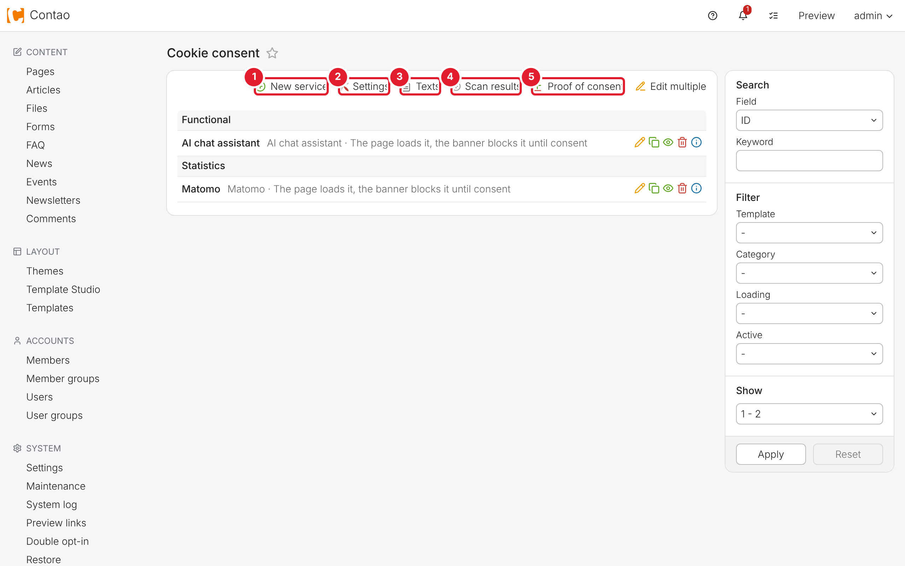

# User manual

Everything is in **NEO Digital › Cookie consent**. The module opens with the
list of services, grouped by category. Above the list are the buttons
**Settings**, **Texts**, **Scan results** and **Proof of consent**; every
sub-page has **Services** to return to the list.

Notes above the list point to open tasks: "The cookie banner is switched off.
Switch it on under "Settings"." – "No privacy policy page is chosen. …" –
"Unknown addresses from the scan: 2. Please check them under "Scan results"."

## What visitors see

### First layer

A heading ("Cookies and services"), a text and three buttons of equal weight:
**Settings**, **Necessary only**, **Accept all**. The text names every
category with its services, e.g. "Statistics (Google Analytics 4); Marketing
(Meta Pixel (Facebook, Instagram))", and whether data may go to the USA or
other countries outside the EU. Below are links to the privacy policy and the
legal notice.

In the picture: 1 the text with the categories and their services, 2 the three
buttons, 3 the links.

### Second layer

**Settings** opens the cookie settings: one switch per category, the services
of each category with provider, purpose, cookies with storage period, third
country and link to the provider's privacy policy (behind **Show services
(…)**), the buttons **Back**, **Save choice** and **Accept all**, and the
consent ID of the visitor once a choice exists. *Necessary* is always on and cannot be switched
off. A category without a service is not shown.

In the picture: 1 the switch of a category, 2 its services, 3 the buttons.

### Embedded content

Videos, maps and posts of a service without consent show a placeholder: "Content
from YouTube is shown here. Loading it sends data such as your IP address to
…", with **Load content** (this once) and **Always allow YouTube** (allows the
service from now on).

### Changing the choice

Visitors reopen the settings with the small button at the bottom of the page,
with the link `{{cookie_consent::settings}}` or the link below the cookie list.
When a visitor switches a category off that was on, the extension deletes the
cookies of its services (and entries of the browser storage with the names
listed for them) and reloads the page.

### Together with other buttons in the same corner

The button to reopen takes part in the buttons at the edge of the screen of
NEO Basic. When buttons of other extensions sit in the same corner (for
example the accessibility panel of NEO Accessibility or the chat of NEO
SuperAgent), they are arranged together as set in the page layout under
**Buttons at the edge of the screen**: one settings button with a menu (the
default), stacked one above the other, or side by side. Alone in its corner,
the button to reopen stays as it is.

1. The **settings button** (a cogwheel) in the shared corner.
2. **Cookie settings** in its menu opens the settings of the banner, as the
   button to reopen does.

With the keyboard: Enter, Space or Arrow down opens the menu on its first
entry, Arrow up on its last; the arrow keys move through the entries, Home and
End go to the first and the last; Esc closes the menu and the focus goes back
to the settings button, Tab closes it and moves on. When the cookie settings
close, the focus goes back to the settings button.

### When visitors are asked again

The banner asks every visitor again when one of these changes: a service is
added, removed or switched off, or its name, category, provider, purpose,
third country, websites or names per language change. Changes to the cookies
or to the provider's privacy link alone do not ask again. The current version
is shown at the bottom of **Settings**.

The banner appears only when at least one active service of the website needs
consent (a category other than *Necessary*). Without such a service, visitors
only see placeholders for blocked embedded content, if any.

## Services

Each row shows the name, the template (or "Own service"), how the service
loads, its ID and, for services added by the scan, "found by the scan on …".
"ID missing" in red means that the banner should load the service but has no
valid ID.

Operations per row: **Edit**, **Copy**, **On/off**, **Delete**, **Details**.
Only active services appear in the banner and in the cookie list.

In the picture: 1 **New service**, 2 **Settings**, 3 **Texts**, 4 **Scan
results**, 5 **Proof of consent**.

### Categories

| Category | For |
| --- | --- |
| **Necessary** | What the website needs to work. Never blocked, always active. The visitor's own choice is listed here as well. |
| **Functional** | Embedded content, chats, fonts of other providers, spam protection |
| **Statistics** | Measuring the use of the website |
| **Marketing** | Advertising, conversion tracking, retargeting, recognising companies |

### Adding a service from a template

1. Click **New service**.
2. Choose the **Template**, e.g. *Google Analytics 4*. The form reloads; the
   extension fills in **Name**, **Category** and **Loading**. Provider,
   purpose, cookies, third country and privacy link come from the template and
   are shown as placeholders: leave them empty to use the template, or
   overwrite them.
3. **Loading**:
   - **The banner loads it after consent**: enter the **ID** from your account
     with the provider, e.g. `G-XXXXXXXXXX`. The help text of the field shows
     the form of the ID. For a self-hosted Matomo also enter the **Address of
     your own server** with `https://`. Remove the code of the service from the
     page layout and the templates; otherwise it loads twice.
   - **The page loads it, the banner blocks it until consent**: the code stays
     where it is (page layout, template, content element). The extension holds
     it back until consent.

   Templates that the extension cannot load itself (e.g. YouTube) have no field
   **Loading**: the page loads them.
4. Leave **Active** on and save.

An ID that does not have the form of the service is refused: "This ID does
not have the form the service uses, e.g. G-XXXXXXXXXX." Matomo without an
address: "Please enter the address of your own server with https://."

Templates (47): statistics – Google Analytics 4, Google Tag Manager, Matomo,
Microsoft Clarity, Hotjar, etracker Analytics, Mouseflow, Plausible Analytics,
Cloudflare Web Analytics; marketing – Google Ads, Google AdSense, Meta Pixel
(Facebook, Instagram), LinkedIn Insight Tag, Microsoft Advertising (Bing Ads),
TikTok Pixel, Pinterest Tag, Snap Pixel (Snapchat), X Pixel (Twitter), Reddit
Pixel, Leadinfo, Leadfeeder (Dealfront), HubSpot, Criteo; functional –
YouTube, Vimeo, Google Maps, OpenStreetMap, Instagram, Facebook, X (Twitter),
Spotify, SoundCloud, Calendly, Typeform, Brevo, Google Docs, Forms, Calendar,
Google reCAPTCHA, hCaptcha, Cloudflare Turnstile, Google Fonts, Adobe Fonts,
tawk.to, Zendesk Chat, Intercom, Trustpilot, ProvenExpert, AI chat assistant.

The template *AI chat assistant* is for a chat assistant that asks for consent itself;
the extension does not block it. Its category must be the consent category set
at the assistant: without a service in that category the banner never asks for
it, and the chat says it is not available. The assistant's form shows this at
the field **Consent category**, with a link that adds the service here.

### Own service without a template

1. Click **New service** and leave **Template** empty.
2. Enter **Name**, **Category**, **Provider** (company and place),
   **Purpose** (one sentence for visitors), **Transfer to a third country**,
   **Privacy policy of the provider** and the **Cookies** (name and storage
   period per row, e.g. `_example` and `1 year`).
3. Either:
   - **Loading** = *The page loads it, the banner blocks it until consent*,
     and under **Addresses** the domains whose scripts and embedded content are
     blocked, one per row, e.g. `widget.example.com`. Subdomains are included.
   - or **Loading** = *The banner loads it after consent* and the **Own code**
     (HTML or script added to the page head after consent). Only
     administrators see this field.
4. Save and switch the service on with **Active**.

### Websites and languages

- **Websites** (section *Addresses and websites*): show the service only on
  the ticked websites. Nothing ticked = all websites.
- **Languages**: appears only when the installation has more than one
  language. Name and purpose per language; empty fields use the name and
  purpose above or the text of the template in that language.

### Services the extension recognises without a listing

Scripts, fonts and embedded content of the 47 templates are held back even
before the service is listed. List them all the same: only listed services
appear in the banner and in the cookie list, and only then can visitors allow
them in the settings.

Elements with the attribute `data-ncc-ignore` are never blocked. A template
listed under *Necessary* is not blocked either.

## Scan results

**Scan results** lists what the scan found: the finding (service or address),
on how many pages and when it was last seen. **Check now** runs the scan at
once. The line above the list says when the last scan ran and how many pages
it read.

| Status | Meaning |
| --- | --- |
| **new** | Found for the first time, no decision yet |
| **added as service** | A template that the scan added to the services |
| **in the banner** | The service is listed already |
| **unknown** | A script or iframe of another host that the catalogue does not know |
| **ignored** | Never added as a service |

- **Add as service** (unknown address) creates an own service that blocks
  this host. It is inactive: complete category, provider and purpose, then
  switch on **Active**. Confirmation: "Service added. Please complete
  category, provider and purpose and then activate it."
- **Edit** changes the status, e.g. to **ignored** for an address that needs
  no consent.
- "loads without consent": on at least one page the service ran without
  consent. Check that **Block scripts** is on, or add the address as a
  service.

The daily scan adds services of the catalogue on its own (active, *The page
loads it*), and sends an e-mail when it added a service or found a new
unknown address. Pages of the own website's domain are not reported.

## Texts per language

Every empty text uses the default of the language: eleven languages are
shipped, every other language gets English.

1. Click **Texts** and then **New language**.
2. Choose the **Language** (the languages of the root pages come first). Each
   language exists once.
3. Fill in only what should differ. Sections: *First layer* (Heading, Text),
   *Settings* (Heading of the settings, Text of the settings, Show services,
   Consent ID), *Buttons* (Accept all, Necessary only, Settings, Save choice,
   Back, Cookie settings), *Categories* (label and description of each),
   *Embedded content* (Placeholder, Load content, Always allow), *Links*
   (Privacy policy of this language, Legal notice of this language, link
   texts).
4. Save.

Placeholders in the texts:

| Field | Placeholder | Replaced by |
| --- | --- | --- |
| **Text** (first layer) | `{services}` | the categories with their services |
| | `{transfer}` | the sentence about transfers to the USA or other third countries, if a service has one |
| **Show services** | `{count}` | the number of services of the category |
| **Placeholder** | `{name}`, `{provider}` | name and provider of the service |
| **Button "Always allow"** | `{name}` | name of the service |

Changing a text does not ask visitors again.

## Proof of consent

**Proof of consent** lists every choice of the visitors, newest first: time,
consent ID, action, allowed categories and version, grouped by day. The
filter selects by action; the search finds a consent ID. **Details** shows one entry,
including **Services allowed one by one**.

| Action | Meaning |
| --- | --- |
| Accepted all | **Accept all** |
| Necessary only | **Necessary only** |
| Choice saved | **Save choice** in the settings |
| Content always allowed | **Always allow …** on a placeholder |

Visitors find their consent ID in the settings of the banner or where
`{{cookie_consent::id}}` is placed. Entries cannot be edited or deleted by
hand; the daily cron deletes them after the period set under **Keep for**.

## Insert tags and content element

| Where | What |
| --- | --- |
| `{{cookie_consent::table}}` or content element **Cookie list** | Tables of all services for the privacy policy |
| `{{cookie_consent::settings}}`, `{{cookie_consent::settings::Own label}}` | Link that opens the cookie settings |
| `{{cookie_consent::id}}` | Consent ID of the visitor |

Details: [Setup](setup.md#4-cookie-list-in-the-privacy-policy).

## Common mistakes

| What happens | What to do |
| --- | --- |
| The banner does not appear | At least one active service with a category other than *Necessary* is needed; check **Show the banner** in **Settings**. |
| A service loads twice | It is set to *The banner loads it after consent* and its code is still in the layout. Remove the code or set **Loading** to *The page loads it*. |
| A new service is not in the banner | **Active** is off, or **Websites** does not include this website. |
| The cookie list is out of date | It always shows the active services; add or correct the services. |

More: [Troubleshooting](troubleshooting.md).
